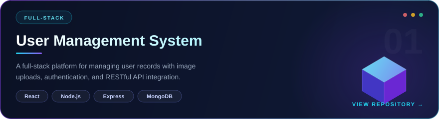
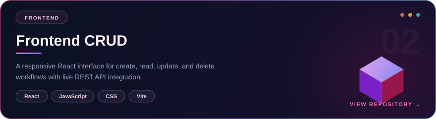

  

  

  
  
  

 

## About Me

I am a final-year **B.Tech Computer Science and Engineering** student at Swami Vivekanand College of Engineering, Indore (RGPV, Bhopal), with hands-on experience in full-stack web development. I enjoy turning ideas into clean, responsive, and reliable web applications.

My core focus is the **MERN stack** — MongoDB, Express.js, React.js, and Node.js — along with RESTful API design, authentication, and modern JavaScript.

- 🔭 Currently strengthening my skills in **backend architecture, API design, and authentication**
- 💼 Open to **internships and entry-level roles** in full-stack and frontend development
- 🤝 Comfortable collaborating on team projects using **Git and GitHub**
- 📍 Based in **Indore, Madhya Pradesh, India** — open to relocation

 

## Tech Stack

  

 

## Featured Projects

  

  

 

## What I Do

- **Full-Stack Development** — Build end-to-end web applications with React, Node.js, Express.js, and MongoDB.
- **REST APIs & Authentication** — Design RESTful APIs and implement secure authentication and data-management flows.
- **Responsive Interfaces** — Create clean, mobile-first user interfaces with modern JavaScript, HTML5, CSS3, and Bootstrap.

 

## Education

> **B.Tech — Computer Science & Engineering**  
> Swami Vivekanand College of Engineering, Indore (RGPV, Bhopal) · **2023 — 2027**

**Relevant coursework:** Data Structures · Web Development · Database Management Systems · Object-Oriented Programming

 

## Connect

  
  
  

 

  

